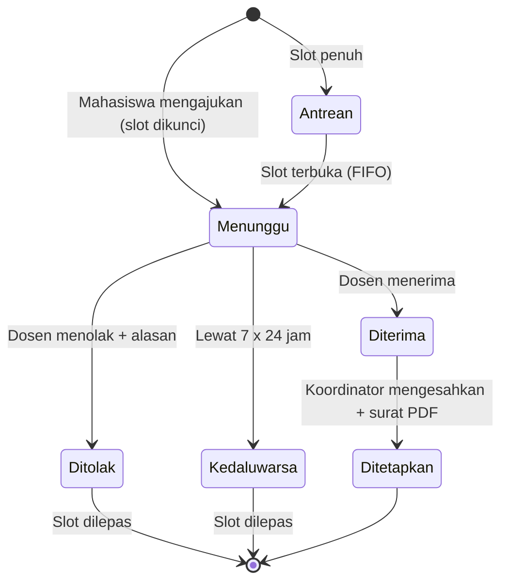

<div align="center">

# 🎓 Sistem Informasi Dosen Pembimbing TA & Skripsi

**Lihat slot dosen pembimbing secara real-time, ajukan dengan judul dan abstrak, dan biarkan sistem yang mengatur kuota, antrean, serta kemiripan judul.**


[Fitur](#-fitur-unggulan) · [Alur](#-alur-pengajuan) · [Mulai Cepat](#-mulai-cepat) · [Akun Demo](#-akun-demo) · [Impor Data](#-impor-data-csv) · [Struktur](#-struktur-proyek) · [Dokumentasi API](backend/README.md)

</div>

---

## ✨ Fitur Unggulan

| | Fitur | Keterangan |
|---|---|---|
| 📡 | **Slot real-time** | Kuota, terisi, dan sisa slot tiap dosen diperbarui otomatis (polling 5 detik). |
| 🔒 | **Anti rebutan slot** | Slot dikunci dalam satu transaksi database, jadi slot terakhir hanya untuk satu mahasiswa. |
| 🧠 | **Rekomendasi dosen (TF-IDF)** | Judul dan abstrak dicocokkan dengan keahlian dan saran judul dosen, tampil 5 teratas. |
| 🛡️ | **Cek kemiripan judul otomatis** | Judul dan abstrak dibandingkan dengan arsip skripsi dan pengajuan aktif; kemiripan ≥ 80% ditolak. |
| 💡 | **Saran judul dari dosen** | Dosen menyiapkan daftar saran judul. Satu saran hanya bisa dipakai satu mahasiswa. |
| ⏳ | **Antrean FIFO** | Slot penuh? Mahasiswa masuk antrean dan dipromosikan otomatis saat ada slot kosong. |
| ⏱️ | **Batas keputusan 7 × 24 jam** | Pengajuan tanpa keputusan menjadi *Kedaluwarsa* dan slotnya dilepas. |
| 📄 | **Surat penetapan PDF** | Koordinator mengesahkan dan sistem menerbitkan surat bernomor `SP-TA/<periode>/<urut>`. |
| 📥 | **Impor CSV** | Impor akun mahasiswa/dosen dan arsip judul skripsi (koma atau titik koma, termasuk hasil Excel). |
| 🔐 | **Akses per peran** | Mahasiswa, dosen, dan koordinator hanya bisa masuk lewat tab perannya masing-masing. |

## 👥 Peran

| Peran | Halaman | Yang bisa dilakukan |
|---|---|---|
| 🎒 **Mahasiswa** | `dashboard.html` · `cari.html` · `pengajuan.html` · `riwayat.html` | Melihat slot dosen, mencari dan meminta rekomendasi, memilih saran judul, mengajukan Pembimbing 1 dan 2, masuk antrean, memantau status, mengunduh surat penetapan. |
| 👨‍🏫 **Dosen** | `dosen.html` | Menerima atau menolak pengajuan (alasan minimal 10 karakter), melihat bimbingan dan sisa kuota, mengelola profil, peminatan, kata kunci, saran judul, dan status menerima. |
| 🧑‍💼 **Koordinator** | `koordinator.html` | Rekap beban dosen, ekspor CSV, tambah dosen, buka/tutup periode, atur kuota dan slot tambahan, pindahkan pengajuan, sahkan penetapan, impor data. |

## 🔄 Alur Pengajuan



1. **Mahasiswa** memilih dosen untuk Pembimbing 1, lalu mengisi **judul dan abstrak**, atau memakai **saran judul** milik dosen itu (abstrak tetap ditulis sendiri).
2. Judul tulisan sendiri dicocokkan otomatis dengan **arsip judul** dan pengajuan aktif. Terlalu mirip berarti ditolak sebelum slot dikunci.
3. Slot dikunci dalam satu transaksi dan status menjadi **Menunggu**. Bila penuh, mahasiswa bisa **masuk antrean**.
4. **Dosen** menerima atau menolak dalam 7 × 24 jam. Slot dilepas bila ditolak atau kedaluwarsa, lalu antrean dipromosikan.
5. **Koordinator** mengesahkan pengajuan yang diterima dan sistem menerbitkan **surat penetapan PDF**.
6. **Pembimbing 2** dipilih setelah Pembimbing 1 aktif, harus dosen yang berbeda, dan judul serta abstraknya mengikuti Pembimbing 1.

## 🚀 Mulai Cepat

**Prasyarat:** PHP 8.2+ (ekstensi `pdo_mysql`, `mbstring`, `openssl`, `fileinfo`, `gd`), Composer 2, MySQL 8. Paling mudah lewat **Laragon** atau **XAMPP**.

```bash
git clone https://github.com/Fathurhur/PTI.git
cd PTI/backend

composer install
copy .env.example .env          # Linux/macOS: cp .env.example .env
php artisan key:generate
```

Buat database, lalu isi tabel dan data contoh:

```bash
mysql -uroot -e "CREATE DATABASE IF NOT EXISTS sistem_dosen_ta CHARACTER SET utf8mb4 COLLATE utf8mb4_unicode_ci"
php artisan migrate:fresh --seed
```

Jalankan aplikasi dan buka **http://127.0.0.1:8000/login.html**:

```bash
php artisan serve
```

> **Penting:** halaman dilayani oleh Laravel supaya halaman dan API satu origin (cookie sesi + CSRF). Membuka file HTML langsung atau lewat Live Server **tidak bisa login**. Bootstrap dan font dimuat dari CDN, jadi butuh internet. Detail pemasangan ada di [`backend/README.md`](backend/README.md).

## 🔑 Akun Demo

Kata sandi semua akun contoh: `rahasia123`. Pilih **tab sesuai peran** di halaman login.

| Peran | Login dengan |
|---|---|
| 🎒 Mahasiswa | NIM `1202230013` (belum punya pembimbing), atau `1202230201` sampai `1202230204` |
| 👨‍🏫 Dosen | NIDN `0412038801` (Dr. Khodijah, IoT), `0410118804` (Yohanes, AI), `0420068503` (Philip, Cyber) |
| 🧑‍💼 Koordinator | `koordinator@prodi.test` |

Mengembalikan data ke kondisi awal: `php artisan migrate:fresh --seed` di folder `backend`. Untuk tampilan **bersih** tanpa pengajuan dan antrean, kosongkan tabel `pengajuan`, `antrean`, `notifikasi`, `log_aktivitas`, lalu set `kuota_dosen.terisi = 0`. Akun, saran judul, dan arsip judul tidak perlu diubah.

## 📥 Impor Data (CSV)

Di halaman koordinator, tab **Impor Data**. Pemisah koma atau titik koma dikenali otomatis, jadi hasil *Save As CSV* dari Excel Indonesia tetap terbaca.

**Akun pengguna**, kolom: `peran, nama, email, kata_sandi, nim, angkatan, nidn, peminatan`

```csv
peran,nama,email,kata_sandi,nim,angkatan,nidn,peminatan
mahasiswa,Budi Santoso,1202230301@mahasiswa.test,rahasia123,1202230301,2023,,
```

**Arsip judul skripsi**, kolom: `judul, tahun, abstrak (opsional), sumber (opsional)`

```csv
judul,tahun,abstrak,sumber
Klasifikasi Penyakit Daun Padi Menggunakan CNN,2025,Penelitian ini membangun model ...,Perpustakaan
```

## 🧪 Pengujian

```bash
cd backend
php artisan config:clear
DB_CONNECTION=sqlite DB_DATABASE=:memory: php artisan test
```

> ⚠️ Selalu pakai SQLite in-memory seperti di atas. Bila ada cache konfigurasi (`bootstrap/cache/config.php`), pengaturan pengujian bisa diabaikan dan tes menjalankan `migrate:fresh` ke MySQL asli, sehingga **data terhapus**.

## 🗂️ Struktur Proyek

```text
PTI/
├── index.html · login.html · 403.html
├── dashboard.html · cari.html · pengajuan.html · riwayat.html   # mahasiswa
├── dosen.html                                                   # dosen
├── koordinator.html                                             # koordinator
├── css/style.css                                                # seluruh gaya
├── js/
│   ├── app.js            # inti: API + CSRF, polling, navbar, modal ajukan, sesi
│   ├── mahasiswa.js · dosen.js · koordinator.js
│   └── data.js           # bidang keahlian, peminatan, teks contoh
└── backend/              # Laravel 11
    ├── app/Http/Controllers/Api/    # endpoint REST
    ├── app/Services/                # aturan bisnis (pengajuan, antrean, TF-IDF, kemiripan, surat)
    ├── database/migrations · seeders
    └── tests/Feature/               # pengujian
```

## 🛠️ Teknologi

- **Frontend:** HTML, Bootstrap 5, Bootstrap Icons, JavaScript (tanpa framework)
- **Backend:** Laravel 11, PHP 8.2+, sesi cookie + CSRF, antrean dan scheduler Laravel
- **Database:** MySQL 8 (pengujian memakai SQLite in-memory)
- **Algoritma:** TF-IDF + cosine similarity untuk rekomendasi dosen dan kemiripan judul
- **Dokumen:** surat penetapan PDF (DomPDF)

---

<div align="center">

Dibuat untuk Program Studi S1 Teknologi Informasi · Kampus Surabaya

</div>
